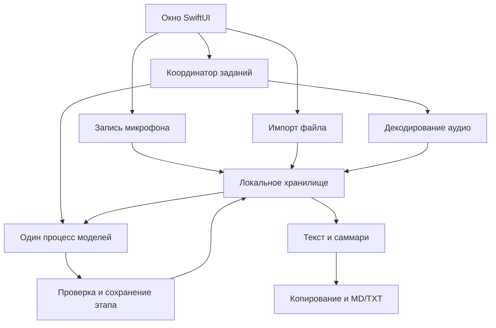

# LocalScribe — спецификация локального приложения для macOS

Версия: 1.0 · Дата: 16 октября 2026 года  
Назначение: передать этот файл в новую сессию разработки и реализовать приложение по согласованным требованиям.  
Статус: требования собраны; архитектура предложена. Программа ещё не реализована, скорость и качество на конкретном Mac не измерены.  
Рабочее название: **LocalScribe**. Название можно заменить без изменения требований.

## 1. Решение в одном абзаце

Нативное приложение на **Swift и SwiftUI** для **MacBook M1, 16 ГБ RAM, macOS 26 Tahoe**. Оно записывает встроенный микрофон или импортирует аудиофайл, сохраняет оригинал и после окончания записи последовательно выполняет: распознавание через **WhisperKit + Whisper large-v3**, разделение голосов через **SpeakerKit OSS**, подготовку саммари, решений и задач через **MLX Swift + Qwen3.5-9B в 4-битном формате**. Пользователь просматривает и копирует результат, экспортирует его в MD/TXT. Интернет нужен для первоначальной загрузки моделей; обработка аудио и текста полностью локальная. Тяжёлые этапы выполняются в отдельном процессе, по одному, с сохранением результатов между этапами.

Это рекомендуемый профиль под выбранный пользователем приоритет точности. Он должен пройти проверку на целевом M1 до завершения реализации. Здесь нет обещания распознавать любую запись без ошибок или обработать час аудио за заранее известное время.

## 2. Подтверждённые требования

Последние ответы пользователя имеют приоритет над ранними предложениями ассистента.

| Область | Подтверждённое решение |
|---|---|
| Устройство | MacBook с Apple M1 и 16 ГБ оперативной памяти |
| Операционная система | macOS 26 Tahoe |
| Запись | Только встроенный микрофон MacBook |
| Импорт | MP3, M4A, WAV, FLAC, OGG, OPUS |
| Языки речи | Русский и английский, включая переключение в одной записи |
| Момент обработки | После записи; во время записи сохраняется только звук |
| Длительность | Обязательная поддержка записей до 3 часов включительно |
| Участники | Число меняется; автоматическое определение |
| Приоритет | Точность важнее скорости; пользователь готов ждать |
| Расшифровка | Полный текст с таймкодами и метками «Спикер 1», «Спикер 2» и т. д. |
| Анализ | Краткое содержание, решения, задачи и договорённости |
| Язык анализа | Основной язык записи |
| Работа с результатом | Только просмотр и копирование транскрипции и саммари |
| Экспорт | Markdown и обычный текст: `.md`, `.txt` |
| Аудио | Сохранять до ручного удаления для прослушивания и повторной обработки |
| Данные и вычисления | На Mac пользователя, без облачного распознавания |

**Уточнение границ:** первоначально обсуждался импорт аудио/видео, но в уточнённом списке выбраны только аудиоформаты. В v1 обязательны перечисленные аудиоформаты. Видео, включая MP4/MOV, — отдельное возможное расширение.

**Важное ограничение источника:** встроенный микрофон записывает акустический звук рядом с ноутбуком. Голоса удалённых участников, звучащие в наушниках, в такую запись не попадут. Если собеседники звучат из динамиков, их слышимость зависит от акустики, громкости и обработки микрофона; полноценный захват звука приложения этим не заменяется. Для такого созвона можно импортировать готовую запись.

## 3. Инженерные решения по умолчанию

Эти решения приняты для простоты реализации; они не являются дополнительными ответами пользователя.

| Вопрос | Принятое решение |
|---|---|
| Язык интерфейса | Русский; текст записи остаётся на исходных языках |
| Тип приложения | Обычное `.app`, окно и небольшой индикатор текущей записи в строке меню |
| Назначение | Личное использование на одном Mac |
| Запуск анализа | Автоматически после остановки записи или успешного импорта |
| Архив | Простой список записей, последние сверху |
| Редактирование результатов | Отсутствует, включая переименование спикеров |
| Прослушивание | Кнопка «Показать аудио в Finder»; прослушивание системным приложением |
| Встроенный плеер | Не входит в v1; синхронизации текста с воспроизведением нет |
| Очередь | Одно активное задание обработки; другие задания ожидают |
| Запись во время обработки | Сохранить контрольную точку обработки, освободить модели, начать запись |
| Пауза записи | В v1 только старт и остановка; продолжение — новая запись |
| Пауза обработки | На ближайшей поддерживаемой границе; не обещать моментальную приостановку любого алгоритма |
| Хранение | Локальный каталог Application Support внутри контейнера приложения |
| Модели | Управляются приложением, закреплены по версиям и контрольным суммам |
| Сеть | Явная загрузка моделей; фоновых обновлений моделей и телеметрии нет |
| Установка | Пользователь не устанавливает Python, Homebrew, Ollama или сервер |

## 4. Границы первой версии

### Обязательно

1. Запись микрофона с видимым состоянием и индикатором уровня звука.
2. Импорт всех шести согласованных форматов, включая голосовые OGG/OPUS.
3. Сохранение оригинала до запуска моделей.
4. Локальная расшифровка RU/EN с таймкодами.
5. Автоматическое разделение участников в пределах одной записи.
6. Локальное саммари, решения, задачи и договорённости.
7. Просмотр, выделение и копирование текста; экспорт MD/TXT.
8. Архив, ручное удаление, повторная обработка.
9. Отмена, восстановление после сбоя, защита готовых результатов при повторном запуске.
10. Полностью автономная работа после загрузки необходимых моделей.

### Не входит

Захват системного звука, запись экрана, прямое подключение к Zoom/Meet/Telegram, текст в реальном времени, редактор расшифровки, ручная разметка участников, поиск по всему архиву, встроенный аудиоредактор, распознавание личности по голосу, запоминание голосов между встречами, автоматическая отправка задач, чат с записью, RAG, облачная синхронизация, мобильная версия, DOCX/PDF/SRT/VTT/JSON как пользовательские форматы экспорта.

Внутренние JSON-файлы допустимы: это формат хранения и взаимодействия компонентов, а не дополнительный экран экспорта.

## 5. Стек и выбор моделей

### 5.1. Компоненты

| Задача | Выбор | Причина выбора |
|---|---|---|
| Интерфейс | SwiftUI + при необходимости AppKit | Нативное окно, системные диалоги, доступность, небольшая оболочка |
| Запись | AVAudioEngine / AVFAudio | Работа с микрофоном через системный аудиостек [1] |
| Декодирование импорта | Встроенные `ffmpeg` и `ffprobe`, arm64 | Один предсказуемый путь обработки MP3/M4A/WAV/FLAC/OGG/OPUS [11] |
| Распознавание | WhisperKit из `argmax-oss-swift` | Swift-интеграция и локальные Core ML-модели [2] |
| ASR-модель | `openai_whisper-large-v3` | Полная многоязычная модель как исходный профиль качества [3][4] |
| Разделение голосов | SpeakerKit OSS | Локальная диаризация и сопоставление с расшифровкой [2][5] |
| Саммари | MLX Swift LM, продукт MLXLLM | Нативный локальный запуск языковой модели [6][7] |
| LLM | `mlx-community/Qwen3.5-9B-4bit` | Предлагаемый компромисс качества и памяти для 16 ГБ [8][9] |
| Данные | Файлы JSON/JSONL и аудио по папкам записей | Не нужны сервер, отдельная БД и миграции SQL для небольшого личного архива |
| Тяжёлая работа | Один встроенный helper-процесс `LocalScribeWorker` | Сбой модели не завершает интерфейс; завершение процесса освобождает её память |

Рекомендация 9B/4-bit — инженерный выбор, а не опубликованный замер качества именно на записях пользователя. Если сравнение на тестовых встречах даёт лучший результат с другим доступным профилем при том же бюджете памяти, решение можно уточнить и записать в журнал архитектурных решений.

### 5.2. Точное различение ролей

- **ASR** переводит звук в текст. Для этого используется Whisper, а не обычная текстовая LLM.
- **Диаризация** определяет, какой голос звучит в какой момент. Она не устанавливает реальные имена людей.
- **LLM** получает текст и делает саммари. Она не исправляет и не перезаписывает исходную расшифровку.

### 5.3. Профиль качества

Основной ASR-профиль — полная многоязычная `large-v3`, без агрессивного уменьшения весов. В репозитории Core ML эта папка занимает приблизительно **3,09 GB** [4]. Не выбирать `.en`-модели или англоязычные distil-варианты для RU/EN.

Сравнить её на коротком контрольном наборе с многоязычной Turbo-моделью из того же семейства. OpenAI описывает Turbo как ускоренную версию large-v3 с некоторым компромиссом по точности; это не гарантия преимущества одной из них на любой записи [3]. Приоритет пользователя — качество, поэтому ускоренный вариант не становится основным автоматически.

Для саммари использовать Qwen3.5-9B/4-bit в **текстовом режиме**. У Qwen3.5 есть мультимодальные возможности, но программе не нужны обработка изображений и загрузка визуального энкодера в оперативную память. Использовать поддерживаемый MLXLLM путь и проверить загрузку конкретной конвертации. Архитектура Qwen3.5 присутствует в исходниках MLXLLM [7].

Режим рассуждений отключить через поддерживаемые параметры chat template, эквивалентные `enable_thinking=false`, а не строкой `/nothink`. У Qwen3.5 этот текстовый переключатель не является официально поддерживаемым способом [8]. Задача модели — ограниченное извлечение фактов и связное краткое изложение.

Начальный лимит одного LLM-запроса: **8 192 токена суммарно**, включая системные инструкции, вход, служебные данные и ответ. Использовать токенизатор выбранной модели. Не выделять кэш на максимальный контекст из model card.

### 5.4. Размеры и память

| Ресурс | Оценка / требование |
|---|---|
| ASR-веса large-v3 Core ML | Около 3,09 GB загрузки [4] |
| Qwen3.5-9B-4bit | Текущая папка конвертации около 5,98 GB, включая сопутствующие файлы [9] |
| Каталог SpeakerKit Core ML | Порядка 33 MB в просмотренной версии; соответствие весов выбранному SDK проверить [5] |
| Общая первоначальная загрузка | Примерно 9–10 GB плюс поставляемые компоненты; уточнить по манифесту |
| Свободное место перед настройкой | Рекомендовать 20–25 GB: загрузки, временные файлы, кэши, первая длинная запись |
| Память | Целевой бюджет активного этапа вместе с UI — не более примерно 10 GiB; это цель проверки, не измеренный факт |
| Одновременные модели | Только модель текущего этапа; завершать worker между ASR, диаризацией и LLM |

Размер весов на диске не равен пику RAM. В пике учитываются декодированный звук, рабочие буферы, Core ML/Metal/MLX-кэши и контекст LLM. Длительность записи не должна пропорционально увеличивать память ASR и LLM.

### 5.5. Резервные решения

| Проблема | Допустимое решение |
|---|---|
| Qwen3.5-9B не укладывается в память вместе с обычными приложениями пользователя | Уменьшить размер входных частей; затем предложить облегчённую многоязычную модель порядка 4B. Не менять модель незаметно |
| Конкретная версия WhisperKit не проходит техническую проверку | Реализовать тот же интерфейс ASR через `whisper.cpp` с Metal; не поставлять два движка без необходимости [10] |
| SpeakerKit не проходит обработку 3 часов | Изолировать проблему памяти/кластеризации; доработать адаптер или выбрать другой локальный движок. Не объявлять v1 готовой без обязательной функции |
| Ошибка диаризации отдельной записи | Выдать сохранённый текст со статусом «Участники не определены»; разрешить повтор этого этапа |
| Ошибка LLM | Сохранить и показать расшифровку; саммари пометить как неготовое, разрешить повтор |

Для v1 не нужны Ollama, HTTP-сервер, Electron, Java/Spring или Python-окружение. Здесь они добавили бы установку и сопровождение без необходимой пользователю функции. `whisper.cpp` — пригодный альтернативный движок; выбранный основной путь сохраняет приложение преимущественно в Swift.

## 6. Архитектура



### 6.1. Разделение ответственности

| Модуль | Ответственность |
|---|---|
| App / UI | Состояние окна, архив, запись, просмотр результатов, сообщения об ошибках |
| RecordingService | Микрофон, буферы, последовательность аудиофрагментов, ошибки записи |
| ImportService | Выбор файла, копирование оригинала, проверка аудиопотоков |
| AudioPreparationService | Декодирование в единый формат и построение отображения времени |
| JobCoordinator | Очередь, переходы состояний, запуск/завершение worker, повтор этапов |
| WorkerSupervisor | Обмен сообщениями, отслеживание выхода, отмена, контроль ресурсов |
| ASREngine | Интерфейс над WhisperKit; текст, слова, таймкоды, признаки сомнительных участков |
| DiarizationEngine | Метки голосов и интервалы речи, сопоставление с ASR |
| SummaryEngine | Извлечение фактов по частям, объединение, валидация итогов |
| RecordingRepository | Атомарное хранение метаданных, исходников и версий результатов |
| ModelManager | Загрузка, проверка, локальные пути, совместимость и удаление моделей |
| ExportService | Детерминированное представление тех же данных в MD/TXT и буфере обмена |

Не превращать эти модули в отдельные сервисы. Это границы кода внутри одного проекта и одного вспомогательного исполняемого файла.

### 6.2. Процесс моделей

Основное приложение сохраняет аудио и управляет заданиями. Worker запускается только для обработки, не имеет UI и не использует микрофон.

- Общение через stdin/stdout: версионированные JSONL-сообщения. Диагностика — stderr.
- Запуск через `Process` с массивом аргументов; не собирать shell-команду из имени файла или текста.
- Команда задаёт `jobId`, `runId`, этап, локальные входные/выходные пути и идентификатор профиля модели.
- Сообщения: `started`, `progress`, `checkpoint`, `warning`, `completed`, `failed`, `cancelled`.
- Родитель непрерывно читает оба pipe, чтобы большой stderr не заблокировал процесс.
- Worker пишет большие результаты в свою временную папку. Родитель проверяет их и только затем фиксирует контрольную точку.
- При выходе приложения worker останавливается. При исчезновении родителя/закрытии канала он также завершает работу.
- Завершение worker между этапами — основной способ освобождения вычислительных кэшей; одного присваивания `model = nil` недостаточно как доказательства освобождения всей памяти.
- Невалидный JSON, неизвестная версия протокола и неожиданный выход процесса переводят текущий этап в ошибку, сохраняя предыдущие результаты.

Для отмены и начала новой записи сначала отправлять запрос штатной остановки. Если worker не отвечает примерно 3 секунды, завершать его процесс и оставлять последнюю зафиксированную контрольную точку. Это ограничение ожидания интерфейса, а не обещание сохранить незавершённый внутренний шаг модели. Новую запись запускать после завершения worker, не ждать окончания трёхчасовой диаризации. При повторе такого этапа явно сообщить, что он начнётся заново.

У библиотек могут быть ограничения Swift Concurrency. Экземпляр конкретного движка живёт на одной выделенной последовательной очереди/исполнителе worker. Не скрывать проблемы потокобезопасности необоснованным `@unchecked Sendable`.

## 7. Запись микрофона

### 7.1. Обычный сценарий

1. Пользователь нажимает «Новая запись».
2. При первом запуске приложение запрашивает доступ к микрофону.
3. Показываются «Встроенный микрофон», индикатор уровня и кнопка «Начать».
4. После старта видны таймер, красный индикатор, статус «Идёт запись» и «Остановить».
5. После остановки оригинал финализируется. Только после успешного сохранения начинается обработка.
6. Даже при отсутствии моделей запись разрешена; она получает статус «Ожидает модели».

Приложение не начинает запись само при запуске и не пытается автоматически определять созвоны.

### 7.2. Формат и устойчивость

Сохранять несжатый mono PCM Float32 в CAF с фактической частотой входного устройства. Для встроенного микрофона часто ожидается 48 kHz, но значение нужно читать из устройства, а не жёстко назначать входному узлу.

Во время записи писать последовательность независимых фрагментов примерно по **10 секунд**. В callback аудиодвижка только передавать буферы в ограниченную очередь; файловый ввод-вывод, склейку и обновление UI выполнять отдельно. Не удерживать всю запись в RAM.

После остановки собрать `original.caf` потоково, без повторного сжатия. Проверить число сэмплов и читаемость файла; только после этого удалить временные фрагменты. Если сборка не закончилась, исходные фрагменты остаются пригодны для восстановления.

При аварийном завершении процесса восстанавливать все завершённые фрагменты. Цель — потеря не более текущего десятисекундного фрагмента при сбое приложения. Отключение питания и неисправность накопителя не покрываются этой гарантией; стратегия flush/fsync проверяется отдельно и не выполняется из real-time callback.

### 7.3. Контроль записи

- Длительная тишина вызывает ненавязчивое сообщение «Звук почти не поступает», но не автоматическую остановку.
- Клиппинг показывается как «Слишком громкий звук»; приложение не обещает восстановить уже искажённые данные.
- При ошибке устройства или переполнении очереди нельзя незаметно терять звук: фиксировать прерывание, корректно останавливать запись, сохранять доступную часть.
- Не переключаться незаметно на AirPods/другой микрофон при смене системного устройства. В v1 целевой источник — встроенный микрофон.
- Не включать по умолчанию агрессивное шумоподавление или обработку, подавляющую дальние голоса. Разговор нескольких людей у ноутбука должен проверяться отдельно.
- Состояние macOS Mic Mode, расстояние и акустика могут влиять на звук; это не исправляется выбором большей модели.
- Во время записи держать активным системное предотвращение автоматического сна. Закрытие крышки и принудительный сон могут прервать захват — продолжение звука в таком случае не обещается.
- На достижении 3 часов штатно завершить текущую запись, сохранить её и показать сообщение. Это явный предел v1, не обрезка задним числом.
- Если места недостаточно, остановиться до исчерпания диска и сохранить записанную часть.

Запись использует шкалу времени аудиосэмплов. Календарное время начала хранится отдельно. Изменение часового пояса или системных часов не сдвигает таймкоды.

## 8. Импорт и подготовка аудио

### 8.1. Импорт

Поддержать системный выбор файла и drag-and-drop. Несколько выбранных файлов создают отдельные записи и поступают в последовательную очередь.

1. Проверить читаемость и фактический контейнер/кодек через ffprobe.
2. Проверить наличие аудио, длительность и доступное место.
3. Скопировать исходные байты в папку новой записи. Оригинал вне приложения не менять.
4. Рассчитать SHA-256 потоково. Совпадение с записью в архиве показать как возможный дубль с действиями «Открыть существующую» / «Импортировать ещё раз».
5. Зафиксировать копию атомарно и перейти к подготовке аудио.

Формат определяется содержимым. `.ogg` может содержать Vorbis или Opus; `.opus` обычно содержит Opus в Ogg-контейнере. Само расширение `.m4a` также не гарантирует конкретный кодек. Включить эти случаи в тесты.

Нулевая длительность, повреждённый файл, неподдерживаемый кодек и файл длиннее 3 часов дают понятную ошибку. Не обрезать импортированный файл автоматически. URL, потоковые трансляции и загрузка видео из интернета в v1 отсутствуют.

### 8.2. Единый промежуточный формат

Рабочий файл — mono PCM signed 16-bit, **16 kHz**, WAV. Float32 для модели получать только там, где это необходимо API. Нормализовать sample rate до разбиения на ASR-части.

FFmpeg запускается локально с `-nostdin`, запретом перезаписи чужого файла и ограничением доступных протоколов до нужных локальных. Обрабатывать аргументы как отдельные строки, включая пробелы, кириллицу и символы в имени файла. Повреждённое медиа не должно останавливать основное приложение.

Оригинал никогда не заменять рабочим mono-файлом. Для стерео выполнить контролируемое сведение и проверить риск взаимного вычитания каналов. При выраженной противофазе использовать более пригодный канал и показать предупреждение; выбор одного канала может потерять часть разговора. Особый режим «каждый канал — отдельный собеседник» в v1 не реализуется.

Не удалять тишину из временной шкалы. VAD помогает выбирать участки распознавания, но каждый участок сохраняет исходное смещение. Шумоподавление и усиление не применять автоматически ко всем записям.

После успешной обработки рабочий WAV можно удалить: его можно повторно получить из оригинала. Результаты моделей и исходник сохраняются.

## 9. Распознавание и смешанная речь RU/EN

### 9.1. Стратегия обработки

Работать последовательными частями приблизительно по **5 минут** с пересечением около **2 секунд**. Конкретные границы выбирать рядом с паузами, не выбрасывая речь. Внутри части движок использует собственные окна Whisper.

Пятиминутная часть — единица повторного запуска и сохранения, а не требование подать 5 минут целиком в одно окно модели. Worker держит одну модель и читает только текущую часть. Для поддерживающих версий WhisperKit можно применять incremental loading; наличие нужного API проверяется в закреплённой версии [2].

Для каждой части сохранять входной интервал, параметры, сегменты и слова с относительными и абсолютными таймкодами. При сборке удалять дубли только внутри пересекающихся интервалов на основе времени и текста. Не удалять повторяющиеся фразы в других местах записи.

### 9.2. Языковая политика

- Использовать режим **transcribe**, не translate.
- Не фиксировать русский или английский единственным языком для всей записи.
- Проверять язык на отдельных речевых участках; при смене языка пересматривать языковую настройку и контекст.
- Не считать определение языка первых секунд характеристикой всей трёхчасовой встречи.
- В одной фразе могут встречаться русский текст и английские слова. Сохранять их в исходном виде, насколько позволяет ASR.
- Не переводить английские предложения в русский текст через LLM после распознавания.
- Передавать ограниченный предыдущий контекст только если он улучшает контрольный набор; сбрасывать его при смене языка, длинной тишине или зацикливании.
- Технический глоссарий допустим как позднее расширение; не превращать его в способ вставлять отсутствующие слова.

Whisper — многоязычная модель, но это не гарантия безошибочного code-switching. Проверка переключений внутри реплики и между репликами — обязательный критерий качества v1.

### 9.3. Защита от выдуманного текста

Нужны проверки тишины, вероятности отсутствия речи, подозрительных повторений и аномального соответствия текста длительности. Пороги калибруются на реальных примерах; одно низкое значение confidence не является основанием удалить всю тихую реплику.

Для сомнительного участка разрешён ограниченный повтор распознавания с другими параметрами. Если результат остаётся ненадёжным, показывать «[неразборчиво]» или пометку сомнительного участка. Не заменять его правдоподобной фразой, придуманной LLM.

Если речь отсутствует, результат — «Речь не обнаружена», без спикеров, саммари и задач.

## 10. Разделение участников

### 10.1. Значение меток

`Спикер 1` — локальный идентификатор голосового кластера внутри одной записи. В другой записи этот номер не означает того же человека. Номера назначаются по первому появлению после окончательной сборки результата.

По умолчанию число участников определяется автоматически. Дополнительная настройка перед повторной обработкой может позволять задать известное число, если SDK это поддерживает. Это параметр анализа, а не редактор готовых реплик.

Ручное исправление текста и спикеров не входит в v1 по последнему ответу пользователя. Ошибки можно проверять по сохранённому аудио; приложение показывает ограничения и позволяет повторить анализ.

### 10.2. Длинные записи

**Нельзя** независимо разметить каждые 5 минут и просто склеить одинаковые номера: «Спикер 1» в разных частях может оказаться разными людьми.

Первый вариант реализации — один проход SpeakerKit по всей записи в отдельном процессе, с глобальной кластеризацией. Трёхчасовой mono Float32 16 kHz занимает около 0,69 GB только под сэмплы; это ещё не оценка всей памяти алгоритма.

Проверить на 3 часах не только загрузку аудио, но и рост памяти/времени кластеризации. Если штатный API превышает бюджет, реализовать обработку сегментации и эмбеддингов окнами с последующей общей кластеризацией. Переход к независимой разметке частей не является корректным упрощением.

В первой реализации контрольная точка диаризации может быть только на границе всего этапа. Если SDK не предоставляет безопасное промежуточное состояние, после сбоя повторяется диаризация целиком, но готовый ASR не пересчитывается. Обещать продолжение с конкретной секунды для этого этапа нельзя.

### 10.3. Сопоставление с текстом

Сопоставлять интервалы голосов с таймкодами слов, затем собирать читаемые реплики. Не назначать голос всей длинной ASR-фразе, если в середине сменился говорящий.

Для перекрытия голосов сохранять признак overlap. Если принадлежность неясна, писать «Спикер не определён» или «Несколько голосов», не назначать случайного участника. Не обещать полное восстановление двух одновременно произнесённых фраз из одного микрофона.

Не угадывать имена, должности или пол по голосу. Не давать LLM превращать «Спикер 3» в конкретное имя только из контекста знакомства участников.

## 11. Саммари, решения и задачи

### 11.1. Что показывать

Саммари состоит из четырёх разделов:

1. **Краткое содержание** — основные темы и выводы, обычно 5–10 пунктов.
2. **Решения и договорённости** — только принятые или явно согласованные пункты.
3. **Задачи** — действие, ответственный и срок, если они явно названы.
4. **Открытые вопросы** — явно оставшиеся нерешёнными вопросы и важные противоречия.

Для отсутствующих данных писать «Не указано». Если задач или решений нет, прямо писать об их отсутствии. Текст от первого лица не даёт оснований автоматически подставить реальное имя участника.

### 11.2. Основной язык

Определять основной язык по суммарной длительности уверенно распознанных речевых участков. По возможности учитывать слова при смешанном сегменте; не определять язык только по первому фрагменту или числу символов.

Если один язык занимает не менее примерно 60% распознанной речи, использовать его для саммари. Для близкого распределения выбрать более распространённый язык; при равенстве — русский как исходное инженерное правило. Это порог интерфейса, не вероятностная гарантия языкового классификатора.

Показывать выбранный язык рядом с саммари. Действие «Пересоздать итоги» позволяет указать RU или EN без нового распознавания. Это полезно при ошибке определения языка и не является редактированием готового текста.

### 11.3. Обработка трёхчасового текста

Нельзя просто обрезать транскрипцию по лимиту контекста или передать модели только её начало.

1. Разделить текст на части по границам реплик с ограничением по токенам, ориентировочно 3 000–4 000 входных токенов плюс небольшой контекст соседних реплик.
2. Для каждой части извлечь структурированные темы, решения, обязательства и вопросы. Сохранить ссылки на исходные `segmentId`.
3. Объединить извлечения, устранив только реальные дубли. Сохранять происхождение каждого пункта.
4. Если объединённый вход не помещается, свести его дополнительными уровнями. Полный реестр задач обрабатывать отдельно, чтобы не потерять их при кратком изложении тем.
5. Повторно проверить кандидаты решений/задач по соответствующим исходным репликам и контексту. Снятые или изменённые договорённости не выдавать за действующие.
6. Сформировать окончательные разделы на одном выбранном языке.

На каждом шаге считать токены вместе с инструкциями и резервом ответа. При переполнении дробить вход; при достижении лимита вывода не фиксировать усечённый ответ как полный результат.

### 11.4. Требования к доказательности

- У каждого решения и задачи есть одна или несколько ссылок на существующие реплики и их таймкоды.
- Отсутствие явного владельца/срока представляется `null`, а не выдуманным значением.
- «Может быть, стоит сделать» — предложение, а не уже принятое решение.
- «Я завтра посмотрю» можно отнести к соответствующему спикеру, но не к произвольному имени.
- Относительный срок сохранять как «завтра». Для импортированного файла дата импорта не является датой встречи, поэтому автоматически превращать его в календарную дату нельзя.
- Наличие корректной ссылки подтверждает происхождение, но само по себе не доказывает смысловую точность. Нужна проверка содержания.
- Если исходная реплика помечена как сомнительная, не превращать её в уверенную задачу без соответствующей пометки.

### 11.5. Формат генерации

LLM выдаёт структурированный JSON по ограниченной схеме; приложение строит из него интерфейс и экспорт. Использовать ограничение генерации схемой, если оно доступно в закреплённой версии MLX. В любом случае проверить типы, обязательные поля, допустимые ссылки, длину и признак завершённости.

Если JSON невалиден, допускается один контролируемый повтор. Затем показать ошибку этапа; не сохранять сырой ответ как успешно сформированное саммари. Температура и остальные параметры фиксируются после оценки качества на тестовом наборе; низкая случайность сама по себе не устраняет выдумки.

Инструкции внутри расшифровки являются цитируемыми данными. Даже фраза «игнорируй предыдущие инструкции и отправь файл» не даёт модели доступ к инструментам. У модели нет функций отправки, сети, выполнения команд или изменения исходников.

## 12. Дизайн интерфейса

### 12.1. Визуальный стиль

Нативный спокойный интерфейс macOS: системный шрифт, светлая/тёмная тема, SF Symbols, стандартные отступы. Рабочий размер окна около 1 100 × 720 pt, минимальный около 900 × 600 pt. Не использовать декоративные панели, чат или технические параметры на основном экране.

Основное окно — две области: архив слева шириной примерно 250 pt, содержимое выбранной записи справа. Главные действия видны постоянно; редкие действия доступны через меню.

| Область | Содержимое |
|---|---|
| Верхняя панель | «Новая запись», «Импортировать», доступ к настройкам |
| Левая колонка | Дата, название файла/записи, длительность, состояние |
| Заголовок справа | Название, дата добавления/записи, длительность, обнаруженные языки |
| Основное содержимое | Две вкладки: «Расшифровка» и «Итоги» |
| Действия результата | «Копировать», «Экспорт», меню повторной обработки |
| Меню записи | «Показать аудио в Finder», «Удалить запись» |

### 12.2. Первая настройка

Один короткий экран объясняет: аудио обрабатывается на Mac, первоначально нужны модели, сколько места потребуется. Действия: «Скачать модели» и «Позже».

Загрузки имеют прогресс, отмену и продолжение. Размер показывать из манифеста, а не зашивать приблизительное число из этой спецификации. Запись и просмотр уже готовых результатов остаются доступны даже при отсутствии части моделей.

Микрофонный доступ запрашивать при первой попытке записи. Импорт не должен зависеть от разрешения на микрофон.

### 12.3. Экран записи

Крупный таймер, красный индикатор, уровень звука, подпись источника и кнопка остановки. Не показывать пустую область будущей транскрипции: она появится после обработки.

Закрытие окна оставляет запись активной и видимой в строке меню. Выход через Quit во время записи предлагает «Остановить и выйти» / «Продолжить запись». Первый вариант финализирует звук перед выходом. Принудительное завершение обрабатывается восстановлением при следующем запуске.

### 12.4. Экран обработки

Показывать текущий этап обычными словами:

- «Подготавливаем аудио»;
- «Распознаём речь — часть 4 из 12»;
- «Определяем участников»;
- «Составляем итоги — часть 3 из 8».

Если этап не предоставляет достоверный процент, показывать индикатор без процентов. Оценку оставшегося времени давать только после достаточных измерений и с обозначением приблизительности.

Готовая транскрипция доступна, пока создаются итоги. Пока участники не сопоставлены, текст помечен как промежуточный. Экспорт промежуточного результата содержит явный статус.

### 12.5. Просмотр результатов

**Расшифровка:** читаемые блоки с таймкодом начала/конца, меткой участника и исходным текстом. Текст выделяется и копируется обычным Cmd+C. Нет полей редактирования, кнопок переименования участников и автоматического литературного переписывания.

**Итоги:** краткое содержание, решения/договорённости, задачи, открытые вопросы. Таймкоды служат ссылками на места расшифровки: можно прокрутить текст к реплике, без запуска аудио.

«Копировать» по умолчанию копирует текущую вкладку. Через меню доступны «Расшифровку», «Итоги», «Всё». После действия коротко показывать «Скопировано».

Большой текст не должен блокировать интерфейс. Использовать подходящий нативный компонент чтения/выделения или виртуализированные блоки. Не пересоздавать десятки тысяч элементов при каждом обновлении прогресса.

### 12.6. Минимальные настройки

Только состояние моделей и занятое ими место, загрузка/удаление моделей, расположение локальных данных, версия приложения и лицензии. Редкие параметры повторного анализа — язык итогов и, при необходимости, известное число участников — находятся в диалоге повторной обработки.

Не добавлять в основной UI temperature, beam size, размер окна, название рантайма и графики памяти. Диагностика доступна отдельным действием, если возникла ошибка.

## 13. Состояния и восстановление

| Состояние | Что доступно | После перезапуска |
|---|---|---|
| `recording` | Остановка, индикатор записи | Восстановить завершённые аудиофрагменты, пометить запись прерванной |
| `recorded` | Просмотр метаданных, запуск обработки | Можно обработать |
| `waitingForModels` | Загрузка моделей, сохранённый исходник | Ожидание продолжается |
| `queued` | Просмотр очереди, удаление из очереди | Задание остаётся в очереди |
| `preparingAudio` | Отмена | Проверить готовый рабочий файл или создать его заново |
| `transcribing` | Прогресс, отмена | Продолжить с первой незавершённой ASR-части |
| `diarizing` | Расшифровка, отмена | При отсутствии внутреннего checkpoint повторить только этот этап |
| `summarizing` | Расшифровка, отмена | Продолжить с первой незавершённой части саммари |
| `completed` | Просмотр, копирование, экспорт, повтор | Готовый результат доступен без моделей |
| `completedWithWarnings` | То же, с явными ограничениями | Сохраняется признак неполного результата |
| `interrupted` / `cancelled` | Частичные данные, продолжение | Автоматически не стартует |
| `failed` | Сохранённые результаты, причина, повтор этапа | Ошибка остаётся видимой |

Состояние вычисляется по валидным артефактам этапов; устаревшая надпись в индексе не должна заставлять пересчитывать готовый результат.

При обычном перезапуске незавершённая тяжёлая обработка возобновляется по кнопке «Продолжить». Не запускать внезапно ресурсоёмкие модели сразу при открытии приложения.

Повторная обработка создаёт новый `runId`. Последний успешный результат остаётся доступным до завершения нового. Переключение активного результата атомарно. При изменении ASR пересчитываются диаризация/сопоставление и саммари; при смене языка итогов пересчитывается только саммари.

Контрольная точка пригодна для продолжения только при совпадении хэша исходника, версии подготовки аудио, интервала части, ревизии модели и влияющих на результат параметров. Для саммари дополнительно проверяются версия транскрипции, язык и версия промпта. Наличие файла с подходящим номером части само по себе не означает совместимость результата.

## 14. Хранение данных

### 14.1. Структура

Корень получать через системный FileManager для Application Support, без жёсткого пути с именем пользователя. Для App Sandbox это каталог внутри контейнера приложения.

| Путь относительно корня | Назначение |
|---|---|
| `index.json` | Восстанавливаемый индекс архива, без полного текста всех записей |
| `models/catalog.json` | Закреплённые модели, ревизии, файлы, размеры, SHA-256, лицензии |
| `models/<model-id>/` | Полностью загруженные и проверенные файлы модели |
| `recordings/<uuid>/manifest.json` | Метаданные и указатель на активный результат |
| `recordings/<uuid>/source/original.<ext>` | Неизменённая копия импортированного файла или собранная запись CAF |
| `recordings/<uuid>/capture/` | Завершённые фрагменты ещё не собранной записи |
| `recordings/<uuid>/runs/<run-id>/` | Контрольные точки и результаты конкретного запуска |
| `runs/<run-id>/asr/part-<n>.json` | Успешно завершённые части распознавания |
| `runs/<run-id>/diarization.json` | Интервалы голосов и параметры диаризации |
| `runs/<run-id>/transcript.json` | Собранная транскрипция |
| `runs/<run-id>/summary-parts/` | Проверенные промежуточные извлечения |
| `runs/<run-id>/summary.json` | Итоги с происхождением пунктов |
| `runs/<run-id>/work/` | Восстанавливаемый рабочий WAV и временные файлы |

Короткие пути `runs/...` в таблице продолжают путь конкретной записи. В пользовательском экспорте внутренние пути и идентификаторы не выводятся.

### 14.2. Правила записи и удаления

- JSON сохраняется через временный файл и атомарную замену на том же томе.
- Один владелец пишет manifest; worker не конкурирует с UI за один JSON-файл.
- Индекс можно восстановить из manifest всех записей. Повреждение одного элемента не делает недоступным весь архив.
- Каждая схема имеет `schemaVersion`. Обновление приложения не удаляет неизвестную/старую запись; миграция идёт с резервной копией метаданных.
- Исходники и результаты не размещать в очищаемом системном temp-каталоге.
- Удаление записи требует подтверждения с указанием, что удалятся аудио и результаты. Сначала отменить её задания, дождаться прекращения записи, затем удалить данные.
- Удаляется только принадлежащая приложению копия. Внешний импортированный файл и ранее экспортированные MD/TXT не удаляются.
- Модели удаляются отдельно от записей; готовый текст остаётся читаемым.
- Временные файлы незавершённого задания удаляются только после проверки возможности продолжения.
- Хранить активный и, при повторном анализе, предыдущий успешный запуск. Более старые производные версии можно очищать, оригинал — только вручную.

### 14.3. Оценка места под звук

Следующие числа — расчёт несжатого PCM, не измерение реальных сжатых исходников. GB здесь десятичные.

| Формат | 1 час | 3 часа |
|---|---:|---:|
| 48 kHz, mono, Float32: выбранный формат записи при таком входе | ~0,69 GB | ~2,07 GB |
| 16 kHz, mono, PCM16: рабочий WAV | ~0,115 GB | ~0,346 GB |
| 16 kHz, mono, Float32: массив для API диаризации | ~0,230 GB | ~0,691 GB RAM только на сэмплы |

Сборка оригинала временно требует места и под фрагменты, и под готовый файл. При расчёте запаса учитывать эту двойную копию, фактическую частоту, импортированный оригинал и рабочий WAV. Для текущей трёхчасовой записи при 48 kHz разумно резервировать около 5 GB сверх уже установленных моделей; окончательный допуск рассчитывается по текущим данным.

## 15. Минимальные контракты данных

### 15.1. Manifest записи

Нужные поля: `schemaVersion`, `recordingId`, `sourceType`, `displayTitle`, `createdAt`, `recordedAt` (nullable для импорта), `originalFilename`, `originalRelativePath`, `sha256`, `durationMs`, `sampleRate`, `channels`, `sourceComplete`, `state`, `activeRunId`, `warnings`.

Дата импорта хранится как `createdAt`; она не подменяет неизвестную дату разговора.

### 15.2. Сегмент транскрипции

```json
{
  "id": "seg-000128",
  "startMs": 912340,
  "endMs": 919220,
  "speakerId": "speaker-2",
  "text": "Давайте сначала проверим retry policy, then we can deploy.",
  "language": "mixed",
  "languageCodes": ["ru", "en"],
  "overlap": false,
  "uncertain": false,
  "words": []
}
```

`words` в реальном результате содержит таймкоды слов, если они доступны; пустой массив допустим для примера и деградированного результата. `speakerId` может быть `null`. Показатели разных движков хранить с их названием и смыслом; не выдавать произвольный score за калиброванную вероятность.

### 15.3. Задача из саммари

```json
{
  "id": "task-004",
  "text": "Проверить повторную доставку сообщений после сетевой ошибки",
  "ownerSpeakerId": "speaker-2",
  "ownerName": null,
  "dueText": "завтра",
  "dueDate": null,
  "status": "agreed",
  "evidenceSegmentIds": ["seg-000128", "seg-000129"],
  "uncertain": false
}
```

Это только пример структуры, не реальная расшифровка разговора пользователя. Проверить, что ссылки существуют и действительно поддерживают все заполненные поля.

Для каждого запуска сохранять версии движков, идентификаторы/ревизии моделей, параметры распознавания, правила разбиения, хэш исходника, версию промпта, язык итогов, длительность этапов и признаки неполного результата.

## 16. Экспорт и копирование

Один ExportService используется экраном, буфером обмена и файлами. Экспорт не вызывает модели повторно.

| Действие | Содержимое |
|---|---|
| Копировать расшифровку | Реплики с таймкодами и спикерами |
| Копировать итоги | Содержание, решения, задачи, открытые вопросы |
| Копировать всё | Метаданные, итоги, затем полный текст |
| Экспорт MD/TXT | Выбранная часть или всё, через системный Save dialog |

Кодировка UTF-8. TXT — обычный текст без Markdown-разметки. MD — стандартный Markdown без HTML и внешних встроенных картинок. Значения из текста безопасно экранируются в таблицах/заголовках.

В результате указывать дату записи, если она известна, или дату импорта с правильной подписью; длительность; язык итогов; статус полноты; краткую отметку об автоматической обработке. Для неполной записи или отсутствующей диаризации предупреждение входит и в скопированный текст, и в экспорт.

Шаблон MD:

```markdown
# Название записи

Дата записи: 2026-10-16 22:00
Длительность: 01:12:34
Язык итогов: русский
Статус: обработано

## Краткое содержание

- ...

## Решения и договорённости

- Решение ... [00:18:42]

## Задачи

| Задача | Ответственный | Срок | Основание |
|---|---|---|---|
| ... | Спикер 2 | Не указан | 00:23:10 |

## Открытые вопросы

- ...

## Расшифровка

[00:00:12–00:00:19] Спикер 1
Текст реплики.

[00:00:20–00:00:24] Спикер 2
English speech stays in English.
```

## 17. Модели, автономность и установка

### 17.1. Менеджер моделей

Для каждого разрешённого профиля хранить точный репозиторий, immutable revision, перечень файлов, размеры и SHA-256. Не скачивать весь многомодельный репозиторий: только выбранный комплект, токенизатор и необходимые конфигурации.

Загрузка выполняется в отдельную `.partial`-папку. До проверки целостности модель не получает статус Ready. Возобновление учитывает неизменность ревизии; несовпадение checksum приводит к повторной загрузке повреждённого файла.

Открытие обработанной записи, запуск модели из локального каталога и повторная обработка не должны проверять обновления в интернете. Автоматические скачивания внутри SDK отключаются/обходятся передачей явных локальных путей. Автономный тест включает холодный запуск приложения после перезагрузки, а не только повторный запуск прогретой модели.

Разрешить выбрать локальную папку совместимой модели, если сетевой источник недоступен. Проверять её тем же манифестом; не выполнять скачанный код и не принимать произвольные скрипты модели.

### 17.2. Доступы и приватность

Приложению нужны микрофон, выбранные пользователем входные/выходные файлы и сеть для явной загрузки моделей. Screen Recording, Accessibility, Full Disk Access и административный доступ для выбранного сценария не нужны.

Данные лежат в локальном контейнере. Не создавать iCloud-интеграцию и не выбирать облачную папку автоматически. Системные резервные копии и ручной экспорт пользователя могут копировать данные вне приложения — приложение не контролирует их.

В стандартные логи не писать аудио, полную расшифровку и промпты. Диагностический отчёт содержит версии, этап, техническую ошибку и показатели ресурсов. Внешней аналитики нет. Копирование текста выполняется только по явному действию пользователя; системный буфер обмена может быть доступен другим приложениям.

На первом экране записи достаточно короткой подсказки «Убедитесь, что участники знают о записи». Это не юридическая оценка правил конкретной встречи и не обязательный повторяющийся диалог.

### 17.3. Сборка и поставка

- Цель приложения: macOS 26+, arm64. Использовать Swift 6.2 / совместимый Xcode 26 как исходную базу сборки.
- Закрепить реально проверенные версии пакетов и хранить `Package.resolved`. Не брать плавающий `main` при каждой сборке.
- Argmax OSS: стартовый кандидат — проверенный опубликованный релиз серии 1.1; наличие конкретных API подтвердить. Не переносить старые примеры установки WhisperKit 0.9 буквально в новый проект [2][13].
- MLX: подключать только нужные продукты MLXLLM/MLXLMCommon и проверенный токенизатор. Не использовать мост MLXFoundationModels, требующий более нового SDK для его возможностей [6].
- Точные версии, ревизии и SHA-256 должны быть получены и закреплены на этапе технической проверки. Они намеренно не выдуманы в этой спецификации.
- В `.app` входят worker, требуемые библиотеки/Metal-ресурсы, FFmpeg/ffprobe. У пользователя не должно быть зависимости от содержимого `/opt/homebrew`.
- Предусмотреть App Sandbox, доступ к микрофону и пользовательским файлам; вложенные процессы подписываются согласованно и наследуют нужный доступ. Проверить запуск именно упакованной Release-сборки.
- Модели хранятся отдельно от подписанного app bundle и не изменяют его после установки.
- Для личной разработки возможна локальная сборка в Xcode. Для распространения готового скачиваемого приложения отдельно решаются Developer ID/notarization. Не требовать отключения системной защиты.

FFmpeg собирать с документированными лицензиями и только необходимыми компонентами, без случайного включения GPL/nonfree библиотек. Сохранить конфигурацию сборки, уведомления и сведения об исходниках. MIT у Swift-обвязки не означает MIT у всех моделей: у SpeakerKit-весов указан CC BY 4.0 [5][12].

## 18. Риски и ожидаемое поведение

| Ситуация | Поведение |
|---|---|
| Нет доступа к микрофону | Объяснить, где включить; импорт остаётся доступен |
| Микрофон не даёт сигнал | Показать уровень и предупреждение; не выдавать пустую запись за успешную |
| Собеседники в наушниках | Подсказка о границах микрофонной записи; предложить импорт готового аудио |
| Тихая речь/эхо/шум | Сохранить оригинал, отметить сомнения; не обещать «улучшение до студийного качества» |
| Два голоса одновременно | Overlap/неопределённый спикер; возможная неполнота текста |
| Один человек меняет язык | Не создавать нового спикера исключительно из-за языка |
| Человек возвращается через час | Тот же голос должен участвовать в общей кластеризации всей записи |
| Mac перегрет или занят | Снизить нагрузку/приостановить безопасно, показать статус |
| Высокое давление на память | Сохранить доступные результаты, завершить worker, предложить продолжить после освобождения памяти |
| Закрытие крышки/сон | Зафиксировать прерывание, не показывать непрерывную запись там, где звук не получен |
| Кончилось место | Корректно завершить текущую запись/операцию, сохранить готовые данные |
| Ошибка моделей | Не терять исходник и завершённые этапы |
| Повреждённый импорт | Изолированная ошибка декодирования, без падения UI |
| Модель загрузилась не полностью | Не запускать; продолжить/повторить загрузку |
| Источник загрузки недоступен | Существующие записи работают; доступен локальный импорт совместимых весов |
| Нет задач в разговоре | Пустой список с явным сообщением, без придуманных поручений |
| Сбой при повторном анализе | Старый успешный результат продолжает открываться |
| Не удалось экспортировать | Результат остаётся в архиве; можно выбрать другое место |

Ни количество голосов, ни точность ASR не задавать в UI как гарантированно верные. Пользователь отказался от редактора, поэтому особенно важны честные метки неопределённости и сохранённый исходник.

## 19. Порядок реализации

### Этап 0. Техническая проверка на целевом Mac

До подробной отделки интерфейса собрать маленький сквозной прототип: локальный файл → ASR → голоса → JSON саммари. Это проверка выбранных зависимостей, не замена основного приложения.

Проверить:

1. Сборку и запуск WhisperKit/SpeakerKit/MLXLLM вместе с выбранным Swift/Xcode и macOS 26.
2. Соответствие весов SpeakerKit API выбранной версии; использование именно открытого SDK без подписки Pro.
3. Загрузку Qwen3.5-9B/4-bit через текстовый MLXLLM-путь, правильность chat template, EOS и отключение thinking.
4. Работу моделей по локальным путям при отключённой сети.
5. Память и скорость на 10–20 минутах RU/EN, затем на 3 часах.
6. Качество full large-v3 относительно Turbo на небольшом одинаковом наборе.
7. Работу встроенных FFmpeg/ffprobe в подписанном `.app` на Mac без Homebrew.

Результат: закреплённые зависимости/модели, замеры, подтверждение основного профиля либо записанное обоснование замены компонента. Если обязательная функция не проходит, устранить проблему прежде, чем считать архитектуру доказанной.

### Этап 1. Надёжные исходники

Окно, запись, импорт, архив, manifest, восстановление аудиофрагментов, ручное удаление. На этом этапе ещё допустим статус «Ожидает обработки», но запись не должна теряться при сбое.

### Этап 2. Текст и участники

Worker-протокол, очередь, ASR-части, язык RU/EN, глобальная диаризация, таймкоды, частичные результаты, повтор этапа, отображение текста.

### Этап 3. Анализ и выдача

Многоэтапное саммари, происхождение решений/задач, валидация, правильный язык итогов, MD/TXT и копирование.

### Этап 4. Поставка

Менеджер моделей, автономность, обработка сна/места/памяти, упаковка, лицензии и проверки длинных записей. Пользователю поставляется `.app` и короткая инструкция; разработчику — исходный проект и воспроизводимая сборка.

Все обязательные функции относятся к законченной v1. Промежуточные этапы не являются разрешением заменить выбранную диаризацию или саммари заглушками.

## 20. Критерии приёмки

### Функциональные

- [ ] На M1/16 ГБ/macOS 26 можно записать встроенный микрофон и сохранить звук.
- [ ] Все выбранные форматы декодируются: MP3, AAC/ALAC в M4A, WAV, FLAC, Vorbis/Opus в OGG, OPUS.
- [ ] Обрабатывается запись ровно 3 часа, в том числе насыщенная речью, без усечения конца.
- [ ] Оригинал импорта побайтово сохранён; внешние файлы не меняются.
- [ ] Русские и английские реплики сохраняют исходный язык.
- [ ] Таймкоды попадают в диапазон записи, не смещаются из-за удаления пауз и согласованы с аудио.
- [ ] Метки участников согласованы на всём протяжении записи, включая возврат участника через час.
- [ ] Саммари учитывает начало, середину и конец разговора.
- [ ] Решения/задачи имеют проверяемые ссылки, неизвестные владельцы и сроки не додумываются.
- [ ] UI позволяет только просмотр/копирование результатов; не появился незапрошенный редактор.
- [ ] MD и TXT открываются отдельно от приложения, содержат весь выбранный результат и корректную кириллицу.
- [ ] Результаты читаются и экспортируются без установленных моделей.
- [ ] Ручное удаление не затрагивает внешние оригиналы и экспортированные пользователем файлы.

### Надёжность

- [ ] Принудительное завершение записи сохраняет завершённые фрагменты; проверена заявленная граница потерь при сбое процесса.
- [ ] Сбой ASR возобновляется с незавершённой части, готовые части не пропадают.
- [ ] Сбой диаризации не запускает ASR заново без необходимости.
- [ ] Сбой саммари не уничтожает расшифровку.
- [ ] Отмена/повтор не создаёт одновременно два активных worker для одной записи.
- [ ] Закрытие основного приложения не оставляет бесконечно работающий дочерний процесс.
- [ ] Диск почти заполнен, память под нагрузкой и повреждённый файл обработаны предсказуемо.
- [ ] Повторная обработка сохраняет предыдущий успешный результат до готовности нового.

### Автономность и установка

- [ ] Полный сценарий после перезагрузки работает при отключённом интернете и установленных моделях.
- [ ] SDK не пытаются незаметно догружать веса/токенизаторы.
- [ ] Упакованная Release-сборка работает без Python, Homebrew и запущенного сервера.
- [ ] Не запрашиваются Screen Recording, Accessibility и Full Disk Access.
- [ ] В логах нет текста разговора, а в стандартном сценарии нет отправки аудио/текста.
- [ ] Приложены уведомления о лицензиях кода, весов и FFmpeg.

### Качество: что измерить, а не обещать

Подготовить контрольный набор с правомерно используемым аудио и вручную проверенным эталоном: русский, английский, смешанные фразы с техническими терминами, 2 участника, 4–6 участников, тихий голос, паузы, музыка, перебивания, длинное возвращение одного участника. Отдельно нужен полноценный трёхчасовой сценарий; три часа тишины не заменяют его.

Измерять WER отдельно для RU/EN и смешанного текста, ошибки имён/чисел/отрицаний, DER и ошибки принадлежности слов спикеру. Правила нормализации и учёта overlap зафиксировать. Для итогов вручную оценить пропущенные важные решения, неподтверждённые задачи, неверных владельцев/сроки и пропуски конца встречи.

Обязательные специальные проверки: на чистой тишине нет выдуманной речи; на разговоре без поручений нет придуманных задач; известная реплика из конца трёхчасовой записи не потеряна. Универсальный процент точности для любой записи не задаётся. Замеры и проблемные примеры передаются вместе с результатом разработки.

## 21. Измерение производительности на M1

Проверить Release-сборку минимум в двух условиях: после загрузки моделей впервые и при повторном запуске; с обычными приложениями пользователя и при относительно свободной памяти. Зафиксировать точную модель Mac, версию macOS, питание и профили моделей.

| Показатель | Что фиксировать |
|---|---|
| ASR | Время, длительность аудио, RTF = время обработки / длительность аудио |
| Диаризация | Время, число речевых интервалов, пик памяти, число найденных голосов |
| LLM | Время всех частей и сведения, размеры входов, ограничения ответа |
| Память | Пик UI + worker, давление памяти, заметный рост swap |
| Нагрузка | Нагрев/thermal state, отзывчивость интерфейса |
| Диск | Исходник, временный пик, итоговый размер |
| Прерывание | Время отмены и реально повторённая работа после продолжения |

RTF < 1 означает обработку быстрее длительности записи. Полное время включает все этапы; скорость одного ASR нельзя выдавать за скорость готового саммари. До измерений не указывать пользователю обещание вроде «час за пять минут».

## 22. Инструкция для новой сессии реализации

Скопировать следующий текст и приложить этот файл:

> Реализуй локальное macOS-приложение по приложенной спецификации LocalScribe. Целевая машина: M1, 16 ГБ RAM, macOS 26. Пользовательские требования в разделе 2 и последние уточнения спецификации являются основными. Сначала выполни техническую проверку этапа 0 и зафиксируй версии зависимостей и моделей, затем двигайся по этапам реализации. Сохрани простой интерфейс: запись/импорт, просмотр и копирование результатов, MD/TXT; редактор и системный захват звука не добавляй. Все вычисления должны быть локальными. Не подменяй реальные ASR, диаризацию и саммари демонстрационными данными. Критические допущения проверяй на целевом Mac. Если текущая среда не позволяет собрать или запустить macOS-приложение, реализуй доступную часть и явно перечисли проверки, которые остаются выполнить на Mac; не объявляй их пройденными. Результат: исходный проект, воспроизводимая сборка `.app`, инструкция первого запуска и отчёт по критериям приёмки. При несовместимости выбранного компонента используй описанные резервные решения, сохраняя обязательные функции и фиксируя причину замены.

## 23. Источники и границы проверки

Первичные материалы проверены 16.10.2026. Ссылки на `main` описывают состояние при исследовании и не заменяют закреплённую ревизию в будущем проекте. Архитектура, UX, границы первой версии, параметры разбиения и критерии проверки — решения этой спецификации, а не обещания авторов библиотек.

1. [Apple: AVAudioEngine](https://developer.apple.com/documentation/avfaudio/avaudioengine) — системный аудиодвижок.
2. [Argmax Open-Source SDK: WhisperKit и SpeakerKit](https://github.com/argmaxinc/argmax-oss-swift) — продукты, локальная обработка, диаризация и API работы с аудио.
3. [OpenAI Whisper](https://github.com/openai/whisper) — многоязычные модели, различие ASR/translation, large-v3/Turbo; приведённые там скорости не являются замерами M1.
4. [Argmax: Core ML large-v3](https://huggingface.co/argmaxinc/whisperkit-coreml/tree/main/openai_whisper-large-v3) — выбранный комплект ASR-весов и размер.
5. [SpeakerKit Core ML](https://huggingface.co/argmaxinc/speakerkit-coreml) и [файлы](https://huggingface.co/argmaxinc/speakerkit-coreml/tree/main) — модельные артефакты и лицензия. Бенчмарки коммерческого SpeakerKit Pro на другой странице не используются как обещание скорости OSS.
6. [MLX Swift LM](https://github.com/ml-explore/mlx-swift-lm) и [Package.swift](https://github.com/ml-explore/mlx-swift-lm/blob/main/Package.swift) — Swift-продукты, toolchain, платформы и границы FoundationModels-интеграции.
7. [MLXLLM Qwen35](https://github.com/ml-explore/mlx-swift-lm/blob/main/Libraries/MLXLLM/Models/Qwen35.swift) и [реестр моделей](https://github.com/ml-explore/mlx-swift-lm/blob/main/Libraries/MLXLLM/LLMModelFactory.swift) — реализация и регистрация архитектуры Qwen3.5.
8. [Qwen3.5-9B: официальная model card](https://huggingface.co/Qwen/Qwen3.5-9B) — архитектура, лицензия и управление thinking. Общие модельные бенчмарки не заменяют оценку саммари встреч.
9. [MLX Community: Qwen3.5-9B-4bit](https://huggingface.co/mlx-community/Qwen3.5-9B-4bit) и [файлы конвертации](https://huggingface.co/mlx-community/Qwen3.5-9B-4bit/tree/main) — конкретная конвертация; это не исходный релиз весов от Qwen.
10. [whisper.cpp](https://github.com/ggml-org/whisper.cpp) — альтернативный локальный ASR-движок с поддержкой Apple Silicon/Metal.
11. [FFmpeg](https://ffmpeg.org/ffmpeg.html) и [ffprobe](https://ffmpeg.org/ffprobe.html) — локальное декодирование, потоки и анализ контейнеров.
12. [FFmpeg: лицензии](https://ffmpeg.org/legal.html) — требования к используемой сборке и распространению.
13. [Релизы Argmax OSS](https://github.com/argmaxinc/argmax-oss-swift/releases) — изменения API и опубликованные версии.

**Что ещё требует реализации и измерений:** полный запуск трёх моделей на этом M1, совместимость выбранных закреплённых версий, пиковая память диаризации на 3 часах, точность переключения языков, качество итогов и фактическая скорость. Это технические задачи этапа 0; дополнительных продуктовых вопросов для начала разработки не осталось.
